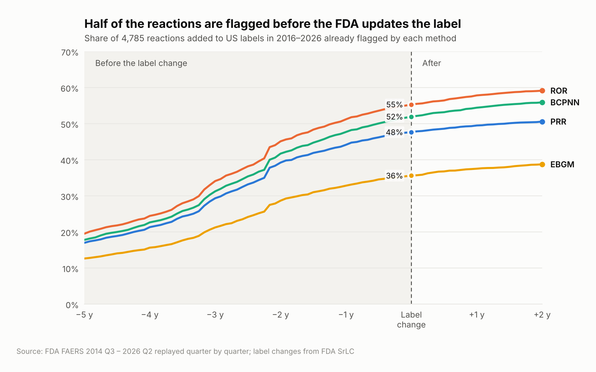

# FAERS Signal Detection Benchmark

[](https://github.com/joanfortunet/faers-signal-benchmark/actions/workflows/ci.yml)

**Which pharmacovigilance signal detection method finds adverse drug reactions best, and earliest?**

This project implements the four classical disproportionality methods from scratch (PRR, ROR, BCPNN and MGPS/EBGM), runs them on 12 years of the FDA Adverse Event Reporting System (FAERS, 2014 Q3 – 2026 Q2, 16.2 M deduplicated cases) and evaluates them against two references built from FDA drug labels: the current label of 285 drugs and 4,785 reactions added to labels between 2016 and 2026, replayed quarter by quarter to measure **time to detection**.

📄 **Full report:** [`reports/report.html`](reports/report.html) (download and open in a browser) · 🔎 **Interactive explorer:** `make app`

## Key results

| | PRR | ROR | BCPNN | EBGM |
|---|---|---|---|---|
| Pairs flagged (of 2.29 M) | 361 k | 417 k | 343 k | 227 k |
| AUC, all clinical events (current labels) | 0.635 | 0.633 | **0.727** | 0.714 |
| AUC, serious drug-induced events | 0.741 | 0.741 | 0.744 | 0.743 |
| Label changes flagged before the change | 48 % | **55 %** | 52 % | 36 % |
| Controls flagged (false alarms) | 22 % | 25 % | 20 % | **13 %** |

1. **With many reports the methods agree; they differ on rare pairs.** 44 % of drug–reaction pairs have a single report. The Bayesian methods (BCPNN, EBGM) shrink them towards "no association", which gives them a clear edge when ranking all events.
2. **Counting reports is a hard baseline.** Against current labels, the raw number of reports (AUC 0.86) beats every method, because labels list many common, non-specific reactions. On serious, typically drug-induced events all four methods perform the same.
3. **Signals often come years before the label.** By the date of the label change, half of the reactions had already been flagged.
4. **Speed vs false alarms.** EBGM raises the fewest false alarms but, when both flag a reaction, it is later than BCPNN in 61 % of cases (median 3 months) and than PRR in 65 % (median 6 months). **BCPNN offers the best balance.**
5. **Machine learning as triage.** Gradient boosting on the four scores plus the case mix (seriousness, reporter type, dynamics) reaches an average precision of 0.36 against 0.08 for the best single method, also when tested on drugs and reactions it has never seen.
6. **Statistics cannot detect artefacts.** Ranitidine became the 2nd most reported drug after the 2019 NDMA recall, with 46 % of its reports filed by lawyers: every method flags a huge, spurious "cancer" signal.

<p align="center">
  
</p>

## How it works

```
FDA quarterly files ──► DuckDB warehouse ──► deduplication & cleaning ──► 2x2 tables ──► PRR · ROR · BCPNN · EBGM
   (48 quarters)          (faers.load)        (sql/02–04, normalize)     (2.29 M pairs)      (faers.methods, faers.ebgm)
                                                                                                     │
          openFDA labels (285 drugs) ─────────────► ranking evaluation + ML ◄───────────────────────┤
          FDA SrLC label changes (2016–2026) ─────► quarter-by-quarter replay (time to detection) ◄─┘
```

| Step | Command | Module |
|---|---|---|
| Download the quarterly files (resumable) | `make download` | `faers.ingest` |
| Load raw tables into DuckDB (incremental) | `make load` | `faers.load` |
| Deduplicate, normalise, classify, count | `make transform` | `sql/`, `faers.normalize`, `faers.transform` |
| Score every pair with the four methods | `make scores` | `faers.methods`, `faers.ebgm`, `faers.scores` |
| Label-based reference (openFDA) | `make reference` | `faers.reference` |
| Time-to-detection replay (SrLC) | `make benchmark` | `faers.srlc`, `faers.temporal`, `faers.benchmark` |
| Export data for the app / open it | `make export`, `make app` | `faers.export`, `app/app.py` |
| Render the report | `make report` | `reports/report.qmd` |

Key data decisions (all documented in the code):

- **Deduplication:** latest version of each case (`fda_dt`, then `primaryid`, as recommended by the FDA); cases deleted by the FDA removed.
- **Drugs:** primary suspect only; active ingredient with salts, hydrates and biosimilar suffixes removed (`SERTRALINE HYDROCHLORIDE` → `SERTRALINE`, `ADALIMUMAB-ADAZ` → `ADALIMUMAB`).
- **Reactions:** MedDRA preferred terms; medication errors, off-label use, lack of efficacy, product issues and exposures excluded (`ref/non_clinical_pt_patterns.csv`, 15 % of reaction rows).

## Notebooks

| Notebook | Content |
|---|---|
| [`01_eda.ipynb`](notebooks/01_eda.ipynb) | Data volume, reporters, missing values, top drugs and reactions, sparsity |
| [`02_methods.ipynb`](notebooks/02_methods.ipynb) | Signal volumes, agreement between methods, shrinkage |
| [`03_evaluation.ipynb`](notebooks/03_evaluation.ipynb) | Ranking metrics, thresholds, ML models, time to detection |
| [`04_case_studies.ipynb`](notebooks/04_case_studies.ipynb) | Montelukast, levofloxacin, ranitidine |

## Interactive explorer

`make app` opens a Streamlit app with two views: the signals of any drug ranked by any method, and the quarter-by-quarter evolution of every reaction that was added to a label, with the date of the label change. It runs on the compact files in `app/data/` (no need to build the warehouse).

## Quality

- 54 unit tests (`make test`), including hand-computed 2x2 examples, a closed-form and a numerical-integration check of the EBGM posterior, recovery of a simulated prior, and a check that the cumulative quarterly counts equal a direct recount.
- Ruff linting and tests run on every push and pull request (GitHub Actions).

## Limitations

- FAERS is a spontaneous reporting system: it cannot give incidence or prove causality, and it is affected by notoriety bias, stimulated reporting and confounding by indication.
- Both references match MedDRA terms to label text: synonyms are missed (*suicidal thoughts* vs *suicidal ideation*), so some true reactions count as negatives.
- A label change marks when the FDA acted, not when a reaction became known; the replay uses the latest version of each case.
- The SrLC history (`ref/srlc_label_changes.csv.gz`) was collected with a browser session because the FDA site does not allow scripted downloads; it covers 277 of the 300 most reported drugs.

## Project structure

```
├── sql/          # SQL steps: deduplication, classification of reactions, 2x2 tables
├── src/faers/    # Python package: ingestion, methods, references, evaluation, export
├── ref/          # Reference files: label-based and SrLC references, term lists
├── tests/        # Unit tests
├── notebooks/    # EDA, methods, evaluation and case studies (executed)
├── app/          # Streamlit signal explorer and its compact data
├── reports/      # Quarto report, figures and result tables
└── data/         # Local data and DuckDB warehouse (not tracked by Git)
```

## Roadmap

- [x] Phase 0: Setup
- [x] Phase 1: Data engineering
- [x] Phase 2: EDA and data quality
- [x] Phase 3: Methods (PRR, ROR, BCPNN, EBGM; EBGM validated by numerical integration)
- [x] Phase 4: Evaluation (label-based ranking, ML, time to detection)
- [x] Phase 5: Case studies and communication (report, app)
- [x] Phase 6: Polish (README, report, tests, CI)

## Future work

- MedDRA-aware matching of label text (synonyms and hierarchy) for a cleaner reference
- Sensitivity analyses: primary + secondary suspect drugs, other signal thresholds
- Cross-check of EBGM with the openEBGM R package
- Hosting the explorer on Streamlit Community Cloud

## References

- DuMouchel W. *Am Stat.* 1999;53:177–190 (MGPS/EBGM)
- Evans SJW, Waller PC, Davis S. *Pharmacoepidemiol Drug Saf.* 2001;10:483–486 (PRR)
- van Puijenbroek EP et al. *Pharmacoepidemiol Drug Saf.* 2002;11:3–10 (ROR)
- Norén GN et al. *Stat Med.* 2006;25:3740–3757; *Stat Methods Med Res.* 2013;22:57–69 (BCPNN)

## License

MIT
