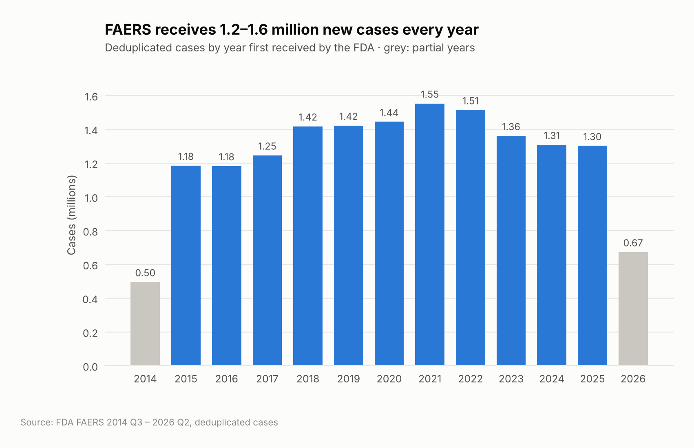
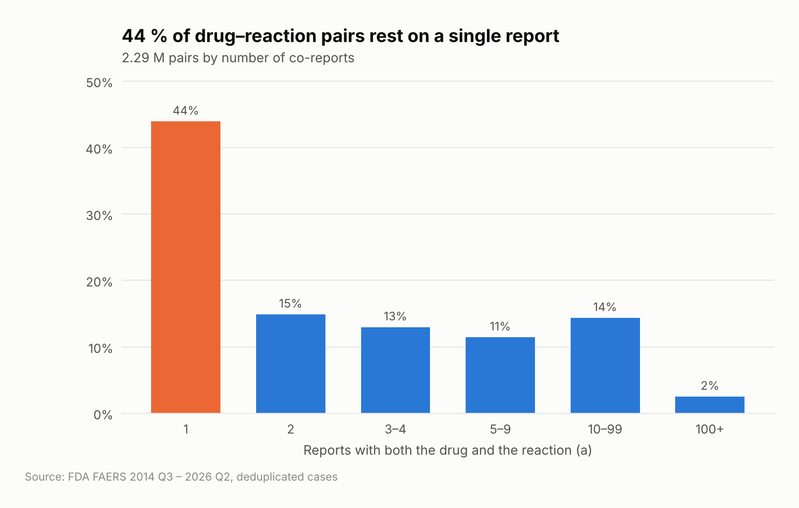
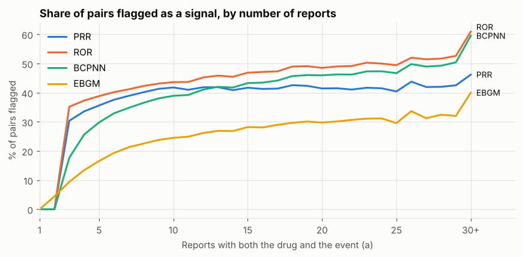
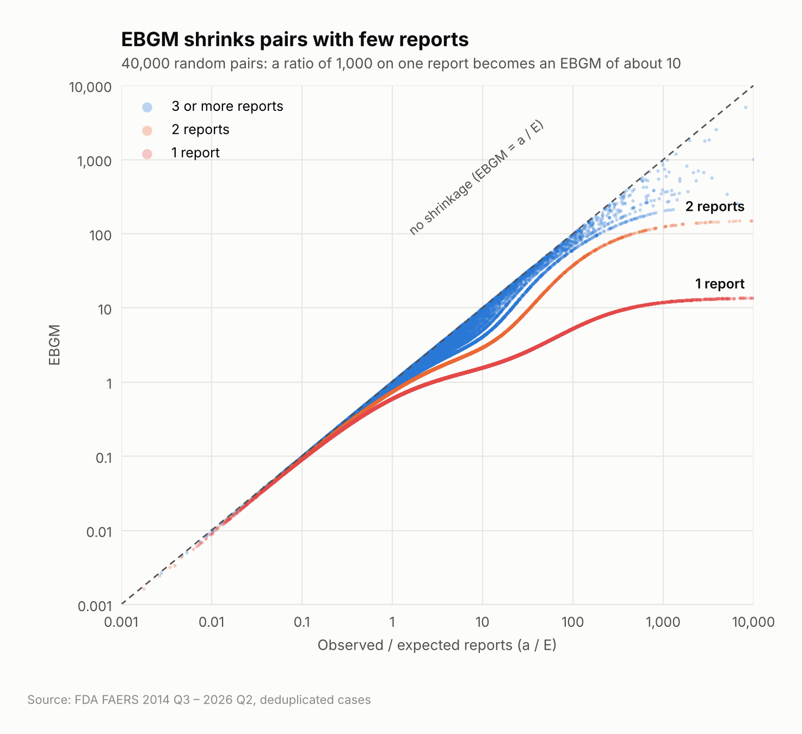
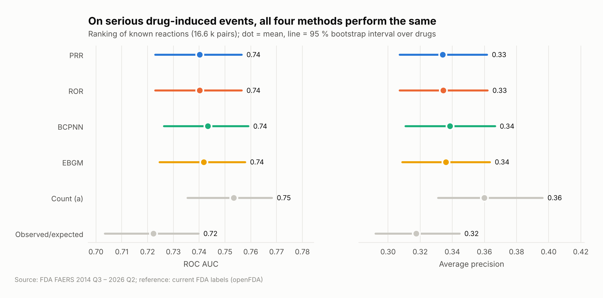
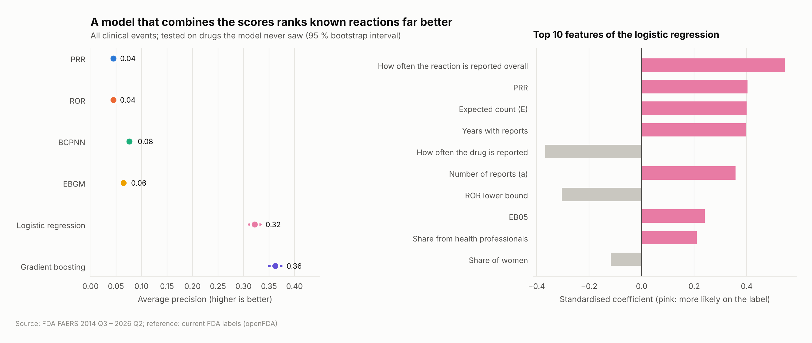
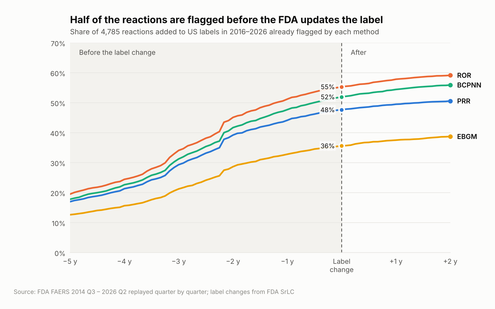
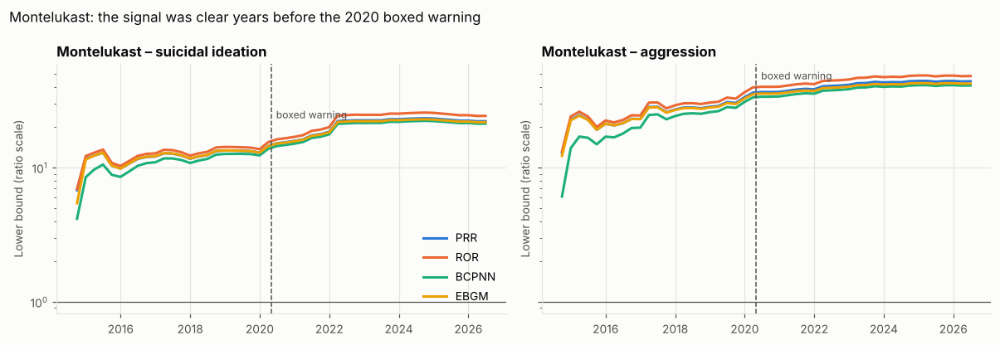
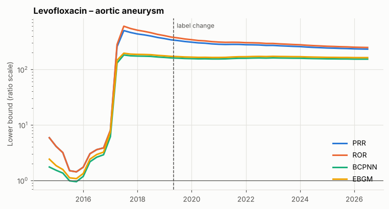
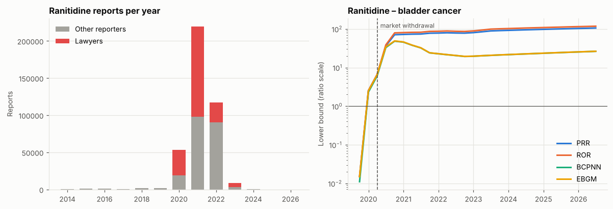

```{python}
import pandas as pd

def table(name, digits=3, **kwargs):
    df = pd.read_csv(f"tables/{name}.csv", **kwargs)
    return df.round(digits)
```

## Summary

Pharmacovigilance teams screen millions of spontaneous reports for *signals*:
drug–reaction pairs reported more often than expected. Four statistical
methods dominate in practice: the proportional reporting ratio (PRR), the
reporting odds ratio (ROR), the Bayesian confidence propagation neural network
(BCPNN, WHO) and the multi-item gamma Poisson shrinker (MGPS/EBGM, FDA). This
project implements all four from scratch and compares them on the FDA Adverse
Event Reporting System (FAERS), 2014 Q3 – 2026 Q2, against two references built
from FDA drug labels.

**Main findings**

- With many reports, the four methods agree (Jaccard 0.81–0.87 between PRR, ROR
  and BCPNN). They differ where it matters most, on rare pairs: 44 % of all
  drug–reaction pairs have a single report, and the Bayesian methods shrink them.
- Against current labels, the **raw number of reports ranks known reactions
  better than any disproportionality method**, because labels list many common,
  non-specific reactions. On serious, typically drug-induced events all four
  methods perform the same (AUC ≈ 0.74).
- Disproportionality often sees reactions **years before** the FDA adds them to
  the label: by the date of the label change, ROR had flagged 55 % of them,
  BCPNN 52 %, PRR 48 % and EBGM 36 %.
- There is a clear **speed–specificity trade-off**: EBGM raises the fewest false
  alarms but flags reactions a median of 3–6 months later than BCPNN or PRR.
  BCPNN gives the best balance.
- A gradient boosting model that combines the four scores with the case mix
  (seriousness, reporter type, dynamics) clearly outperforms every single method
  as a triage score (average precision 0.36 vs 0.08).
- Case studies show what statistics cannot do alone: the ranitidine "cancer"
  signal is an artefact of litigation-driven reporting.

## 1. Data

```{python}
#| label: tbl-funnel
#| tbl-cap: "From raw report rows to the analysis universe (48 quarters)."
pd.DataFrame({
    "Step": ["Report rows in the raw quarterly files", "Unique cases after deduplication",
             "Cases with a primary suspect drug and a clinical reaction",
             "Drug–reaction pairs"],
    "Count": ["19.0 M", "16.2 M", "14.2 M", "2.29 M"],
})
```

The pipeline (Python + DuckDB, all steps tested) keeps the latest version of
each case as recommended by the FDA, removes deleted cases, normalises drug
names (salts, biosimilar suffixes, combination order) and excludes preferred
terms that are not adverse reactions (medication errors, off-label use, lack of
efficacy, product complaints, exposures; 15 % of reaction rows).



Reports come mostly from consumers (44 %) and from the US (69 %); age is missing
in 43 % of cases. The drug–reaction table is extremely sparse:



## 2. Methods

| Method | Estimate | Signal when |
|---|---|---|
| PRR | Proportional reporting ratio (95 % CI) | a ≥ 3, PRR ≥ 2, χ² ≥ 4 (Evans et al., 2001) |
| ROR | Reporting odds ratio (95 % CI) | a ≥ 3 and lower bound > 1 |
| BCPNN | Information component with shrinkage | IC025 > 0 (Norén et al., 2006, 2013) |
| MGPS | Empirical Bayes geometric mean, two-gamma prior | EB05 ≥ 2 (DuMouchel, 1999) |

The EBGM implementation was validated against a posterior computed by direct
numerical integration, and its prior fit against simulated data.





## 3. Evaluation design

**Reference 1 – current labels.** For the 300 most reported drugs, the current
FDA label was taken from openFDA. A pair is *positive* if its reaction appears in
the boxed warning, contraindications, warnings and precautions or adverse
reactions; *negative* if it does not appear anywhere in the label (285 drugs,
982 k pairs, 3.2 % positive).

**Reference 2 – dated label changes.** The FDA Safety-related Labeling Changes
database lists every safety change since 2016 with the text added. A reaction
mentioned in an addition gets the date of the change (4,785 reactions, 261
drugs). The database is then **replayed quarter by quarter**, using only cases
received by each date, to find when each method first flagged each reaction.

## 4. Results

### Ranking known reactions

```{python}
#| label: tbl-ranking
#| tbl-cap: "Ranking metrics against current labels (each method ranks by its lower bound)."
t = pd.read_csv("tables/ranking_metrics.csv", header=[0, 1], index_col=0).round(3)
t.loc[:, (slice(None), ["auc", "ap"])]
```



```{python}
#| label: tbl-threshold
#| tbl-cap: "Each method at its usual signal threshold."
table("threshold_metrics", index_col=0)
```

### Machine learning

```{python}
#| label: tbl-ml
#| tbl-cap: "Out-of-fold performance (5-fold cross-validation grouped by drug; last row grouped by reaction)."
t = pd.read_csv("tables/ml_metrics.csv", header=[0, 1], index_col=0).round(3)
t.loc[:, (slice(None), ["auc", "ap"])]
```



The most important feature is how often a reaction is reported overall: part of
the gain comes from learning which kinds of reactions end up on labels. The
model is best seen as a triage score on top of the statistical signal.

### Time to detection

```{python}
#| label: tbl-ttd
#| tbl-cap: "Reactions added to labels 2016–2026: share flagged, lead time and false alarms."
table("time_to_detection", index_col=0)
```



```{python}
#| label: tbl-h2h
#| tbl-cap: "Emerging signals, head to head: when both methods flag a reaction, which is first?"
table("head_to_head", 2, index_col=0)
```

## 5. Case studies







## 6. Limitations

- Spontaneous reports cannot give incidence or prove causality, and are
  affected by notoriety bias, stimulated reporting and confounding by indication.
- Both references rely on matching MedDRA preferred terms to label text:
  synonyms are missed (for example *suicidal thoughts* vs *suicidal ideation*),
  so some true reactions count as negatives.
- A label change marks when the FDA acted, not when a reaction became known.
- The replay uses the latest version of each case, which may contain
  information that was not available at the time.
- Only primary suspect drugs and drugs with an available label were analysed.

## Reproducibility

All code, tests and reference files are in
[github.com/joanfortunet/faers-signal-benchmark](https://github.com/joanfortunet/faers-signal-benchmark):
`make data` builds the warehouse, `make reference` and `make benchmark` run the
evaluation, and `make app` opens the interactive signal explorer.

## References

- DuMouchel W. Bayesian data mining in large frequency tables, with an application to the FDA spontaneous reporting system. *Am Stat.* 1999;53:177–190.
- Evans SJW, Waller PC, Davis S. Use of proportional reporting ratios (PRRs) for signal generation from spontaneous adverse drug reaction reports. *Pharmacoepidemiol Drug Saf.* 2001;10:483–486.
- van Puijenbroek EP et al. A comparison of measures of disproportionality for signal detection in spontaneous reporting systems for adverse drug reactions. *Pharmacoepidemiol Drug Saf.* 2002;11:3–10.
- Norén GN, Bate A, Orre R, Edwards IR. Extending the methods used to screen the WHO drug safety database towards analysis of complex associations and improved accuracy for rare events. *Stat Med.* 2006;25:3740–3757.
- Norén GN, Hopstadius J, Bate A. Shrinkage observed-to-expected ratios for robust and transparent large-scale pattern discovery. *Stat Methods Med Res.* 2013;22:57–69.
